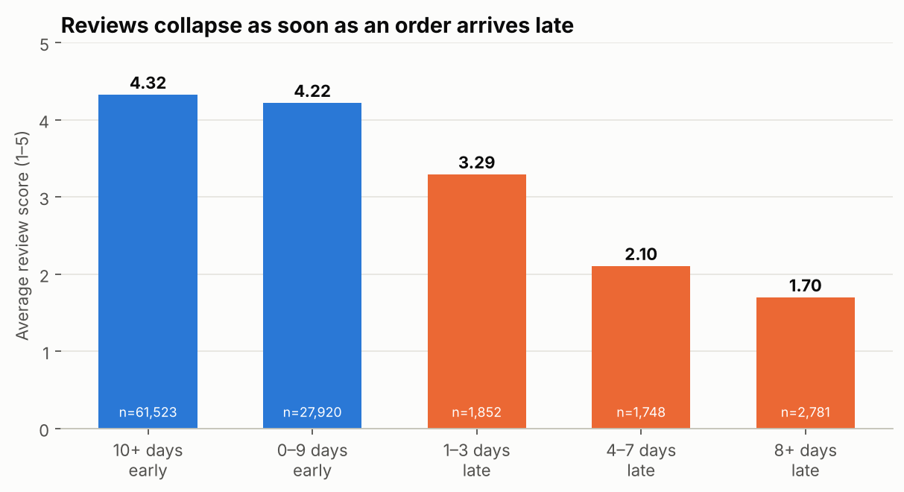
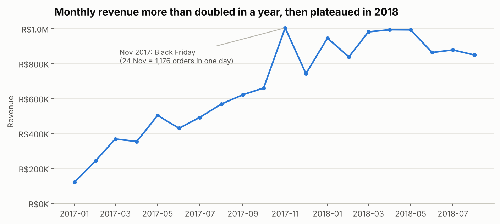
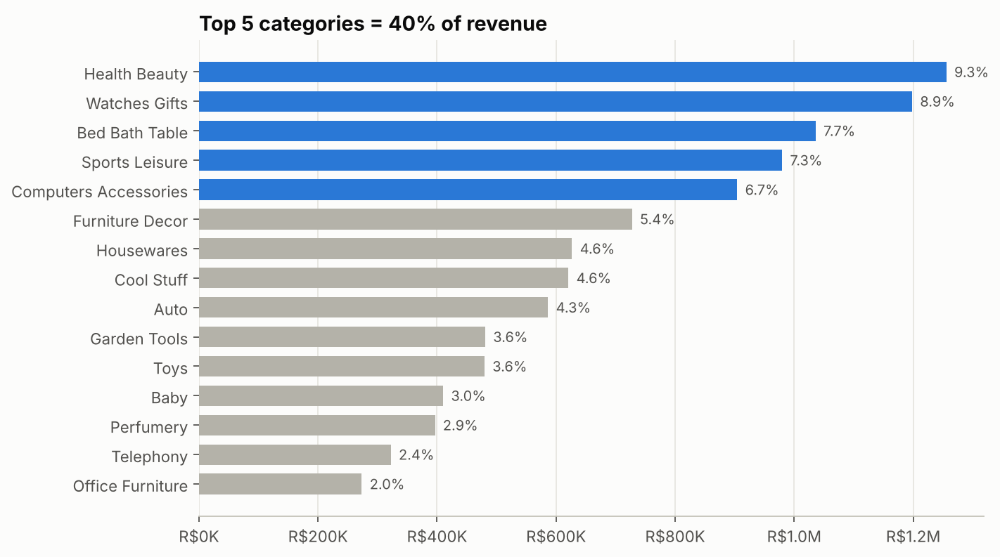
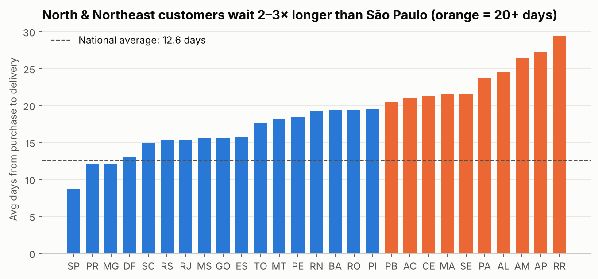
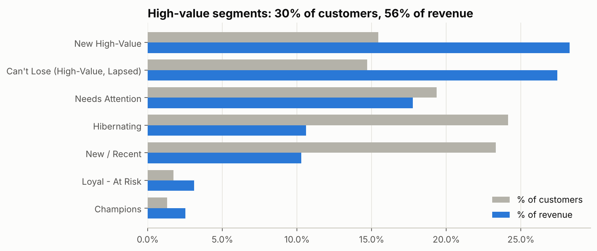
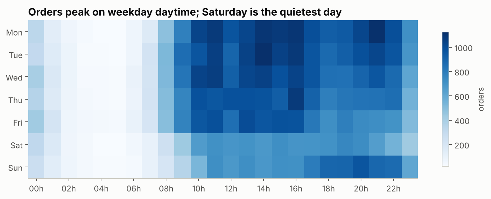

# E-commerce Sales Analysis & Power BI Dashboard — Olist Brazil

End-to-end analysis of **~100k orders** from Olist, a Brazilian online marketplace (2016–2018):
data cleaning in Python → star-schema modelling → SQL business questions → insights notebook → Power BI dashboard.

**Tools:** Python (pandas, matplotlib) · SQL (DuckDB) · Power BI (DAX, data modelling) · Jupyter

---

## Key findings

| | Finding | So what? |
|---|---|---|
| 🚚 | **Late deliveries wreck satisfaction:** late orders average **2.27★ vs 4.29★** on time, and **62%** of late orders get a 1–2★ review | Logistics is the #1 lever for customer experience |
| 🔁 | **Only 3% of customers ever buy again** | The business runs almost entirely on acquisition — retention is the biggest opportunity |
| 📈 | Revenue **+138% YoY** (Jan–Aug 2018 vs 2017), but **flat at ~R$0.9M/month** through 2018 | Growth came from more customers, not bigger baskets (AOV flat at ~R$160) |
| 🛍️ | **Black Friday 2017** = 1,176 orders in one day (~5× normal) | Peak events need stock & delivery capacity planned weeks ahead |
| 🗺️ | SP + RJ + MG = **66% of orders**; North/Northeast customers wait **20–29 days** vs 8.8 in São Paulo, and pay higher freight relative to price | Under-served regions; a Northeast fulfilment hub could unlock demand |
| 💎 | High-value RFM segments are **30% of customers but 56% of revenue** | Target win-back and VIP campaigns at them |
| 💳 | Credit card = **76%** of orders, avg **3.6 instalments** | Instalment plans are essential in Brazil |



<details>
<summary>More charts</summary>







</details>

Full analysis with code, tables and recommendations: **[notebooks/olist_sales_analysis.ipynb](notebooks/olist_sales_analysis.ipynb)**

## Recommendations

1. **Fix late deliveries first** — track seller/carrier late rate, prioritise high-late lanes (RJ, BA, CE, MA, AL), send proactive delay notices with a coupon.
2. **Build retention** — post-purchase email flow, loyalty points, "buy again" recommendations. +2pp repeat rate ≈ +1,900 orders.
3. **Win back high-value lapsed customers** (*Can't Lose* segment: 14,000 customers, 27% of revenue).
4. **Expand logistics in the Northeast** to cut 20+ day delivery times and freight costs.
5. **Plan for peak events** (Black Friday) with seller capacity and stock forecasts.

---

## Power BI Dashboard

4 pages: **Executive Overview · Sales & Products · Delivery & Experience · Customers**

<!-- After building the dashboard, add screenshots here:

-->

- Data model (star schema), 30+ DAX measures (YoY, MoM, YTD, Pareto, RFM shares, late-delivery impact)
- Build guide (Thai): [powerbi/README.md](powerbi/README.md) · Measures: [powerbi/measures.dax](powerbi/measures.dax) · Theme: [powerbi/olist_theme.json](powerbi/olist_theme.json)

### Data model

```
            dim_date        dim_customer ── customer_rfm
                 \             /
                  ▼           ▼
                   fact_orders
                        │ order_id
                        ▼
  dim_product ──▶ fact_order_items ◀── dim_seller
```

---

## Project structure

```
├── data/
│   ├── raw/              # 9 Olist CSVs from Kaggle (not committed)
│   └── processed/        # star schema output for Power BI (not committed)
├── src/
│   ├── download_data.py  # Kaggle API download
│   ├── prepare_data.py   # cleaning + fact/dim tables + RFM segmentation
│   └── run_sql.py        # runs every query in sql/ with DuckDB
├── sql/                  # 10 business-question queries (CTEs, window functions)
├── notebooks/
│   └── olist_sales_analysis.ipynb
├── powerbi/              # DAX measures, theme, step-by-step build guide
└── reports/figures/      # charts exported by the notebook
```

## How to reproduce

```bash
pip install -r requirements.txt
```

```bash
python src/download_data.py
```

```bash
python src/prepare_data.py
```

```bash
python src/run_sql.py
```

```bash
jupyter notebook notebooks/olist_sales_analysis.ipynb
```

Then open Power BI Desktop and follow [powerbi/README.md](powerbi/README.md).

## Data cleaning decisions

- **Revenue** = item price of orders not `canceled`/`unavailable` (freight excluded). AOV uses the paid amount (incl. freight).
- Customers are identified by `customer_unique_id` (the raw `customer_id` changes with every order).
- Orders with several reviews keep the most recent one; products with no category are labelled `Unknown`.
- Trend comparisons use Jan 2017 – Aug 2018 because 2016 and Sep–Oct 2018 contain only a few orders.
- `is_late` = delivered after the estimated date shown to the customer.
- Integrity checks (unique keys, no orphan foreign keys) run on every build.

## Limitations

No cost/margin data (revenue = GMV, not profit) · data ends in 2018 · reviews are voluntary (self-selection bias).

---

## สรุปภาษาไทย

โปรเจควิเคราะห์ยอดขาย E-commerce จากข้อมูลจริงของ Olist (บราซิล) ประมาณ 1 แสนออเดอร์
ทำครบทั้ง pipeline: ทำความสะอาดข้อมูลด้วย Python → ออกแบบ Star schema → ตอบคำถามธุรกิจด้วย SQL →
วิเคราะห์ใน Jupyter Notebook → สร้าง Dashboard ใน Power BI

**Insight หลัก**
- ออเดอร์ที่ส่ง **ช้ากว่ากำหนด ได้รีวิวเฉลี่ย 2.27 ดาว** เทียบกับ 4.29 ดาวเมื่อส่งตรงเวลา → การขนส่งคือปัจจัยสำคัญที่สุดต่อความพึงพอใจ
- ลูกค้า **กลับมาซื้อซ้ำเพียง 3%** → โอกาสใหญ่ที่สุดคือการรักษาฐานลูกค้า
- รายได้โต **138%** เทียบปีต่อปี แต่ช่วงปี 2018 เริ่มทรงตัว
- ลูกค้าภาคเหนือ/ตะวันออกเฉียงเหนือของบราซิล รอของ **20–29 วัน** เทียบกับ 8.8 วันในเซาเปาโล

**ทักษะที่แสดงในโปรเจค:** Data cleaning, Data modelling (Star schema), SQL (CTE, Window functions),
EDA & Visualization, Customer segmentation (RFM), DAX (Time intelligence), Dashboard design, Business storytelling

---

*Dataset: [Brazilian E-Commerce Public Dataset by Olist](https://www.kaggle.com/datasets/olistbr/brazilian-ecommerce) (CC BY-NC-SA 4.0).*
